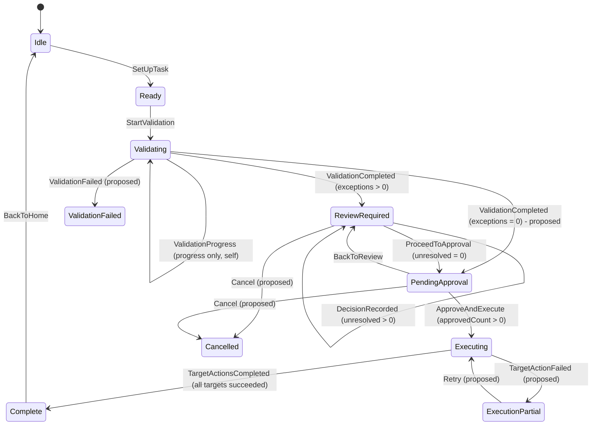
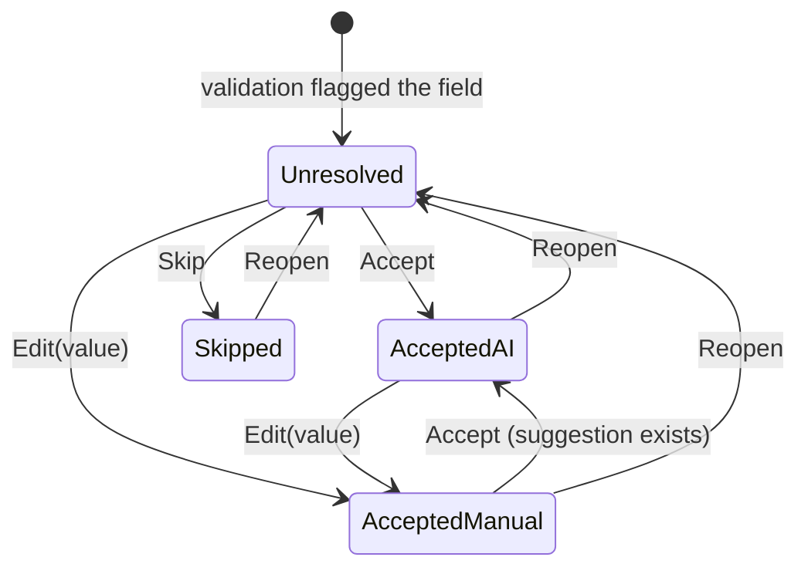
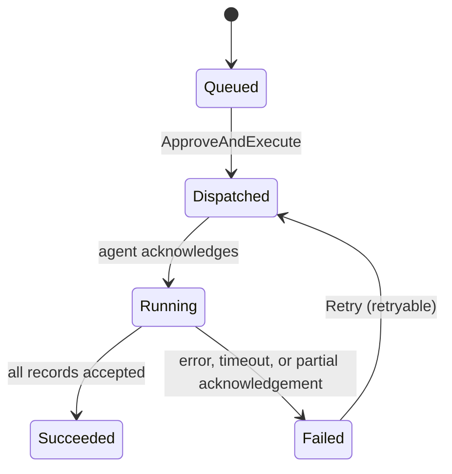
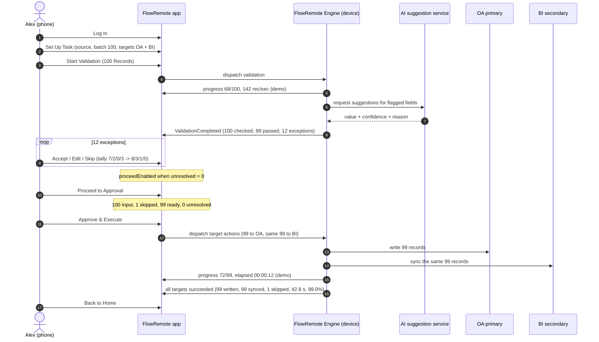

# FlowRemote AI-RPA - Task State Machine Specification

| Field | Value |
| --- | --- |
| Product | FlowRemote AI-RPA |
| Document | State machine specification, level 0 to level 4 |
| Version | 0.1 - draft for review |
| Date | 2026-10-11 |
| Source of truth | Storyboard `Untitled.pdf`: 11 mobile screens for TASK-1001, plus 4 designer annotations |
| Companion document | `flowremote-prd.md` (requirements, business rules, data model) |
| Scope | Task TASK-1001 "Order Data Validation & Sync", predefined workflow, one device, one primary and one secondary target |

---

## 1. Notation

A transition is written as:

```
From --[ event ] [ guard ] / action --> To
```

- **Event**: something that happens (a tap, a device report, a timer).
- **Guard**: a condition that must hold for the transition to fire. A guard is never a UI-only rule; it is enforced server-side.
- **Action**: side effects executed on entry to the target state.
- **States in bold** exist in the storyboard. States marked *proposed* are required for correctness but are not drawn in the storyboard.

Every state change appends one activity event (BR-10) with actor, engine, and timestamp.

## 2. Machine levels

| Level | Machine | States | Owner |
| --- | --- | --- | --- |
| L0 | Session | 2 | Client, validated by server |
| L1 | Task lifecycle | 8 in the storyboard, 11 including failure states | Server authoritative |
| L2 | Exception item | 4 | Server authoritative, driven by operator decisions |
| L2b | Review tally | 4 counters, derived | Server authoritative |
| L3 | Target action (one per target) | 5 | Device agent, reported to server |
| L4 | Validation run | 4 | Device agent |

The phone renders L1 to L3 and never owns them. If the phone and server disagree, the server wins and the phone re-renders.

## 3. L0 - Session machine

| State | Meaning | UI |
| --- | --- | --- |
| SignedOut | No valid session | Login screen |
| SignedIn | Session bound to one operator | Home and task screens |

```
SignedOut --[ SignInSubmitted ] [ credentials valid ] / create session, record operator --> SignedIn
SignedIn  --[ SignOutTapped ]                            / revoke session              --> SignedOut
SignedIn  --[ SessionExpired ]                           / mark session stale          --> SignedOut
```

Notes:

- A task keeps running on the device while the operator is SignedOut. Signing back in returns the operator to the task's current L1 state, not to Home.
- Every L2 decision and the L1 approval carry the operator id from the session (INV-11).

## 4. L1 - Task lifecycle

### 4.1 States

| State | Storyboard screen | Entry condition | Entry action | Exit action |
| --- | --- | --- | --- | --- |
| **Idle** | Home | Session valid, no active task | Load device status and the predefined workflow card | - |
| **Ready** | Task Setup | Task created or resumed with a resolved source and at least one target | Resolve the batch size, render the source and target summary, show the approval notice | - |
| **Validating** | Validating | Operator started validation | Dispatch validation to the device, start the progress stream, start the heartbeat timer | Stop the stream and the heartbeat |
| **ReviewRequired** | Awaiting Review | Validation completed with exceptionCount > 0 | Load exceptions and the tally, compute `proceedEnabled`, set the review timer | Stop the review timer |
| **PendingApproval** | Execution Approval | Review completed with unresolved = 0 | Compute input, skipped, and ready counts, resolve dispatched actions per target | Freeze the review snapshot for this attempt |
| **Executing** | Executing | Approval recorded | Dispatch one target action per target, start the progress stream, start the heartbeat timer | Stop the stream and the heartbeat |
| **Complete** | Results | All target actions reached a terminal success | Compute duration and success rate, append the summary event, load the first page of the activity log | - |
| *ValidationFailed* | none | Validation ended in error | Preserve partial results, expose the reason code and a retry | - |
| *ExecutionPartial* | none | At least one target action failed or the write set is incomplete | Record per-target outcome, expose a safe retry | - |
| *Cancelled* | none | Operator or admin cancelled before approval | Discard the run, keep the source untouched | - |

### 4.2 Diagram



### 4.3 Transition table

| # | From | Event | Guard | Action | To | Emits |
| --- | --- | --- | --- | --- | --- | --- |
| T1 | Idle | `SetUpTask` | Task template resolvable | Create task, bind device, resolve source | Ready | `task_setup_viewed` |
| T2 | Ready | `StartValidation` | Source readable, recordCount > 0, device Online | Dispatch validation, batch size fixed for the run | Validating | `validation_started` |
| T3 | Validating | `ValidationProgress` | Same run id | Update checked count and progress | Validating | - |
| T4 | Validating | `ValidationCompleted` | exceptions > 0 | Persist exceptions, set tally to (0, 0, 0, exceptionCount) | ReviewRequired | `validation_completed` |
| T5 | Validating | `ValidationCompleted` | exceptions = 0 | Set ready = input | PendingApproval | `validation_completed` |
| T6 | Validating | `ValidationFailed` | - | Preserve partial results, set reason code | ValidationFailed | `validation_failed` |
| T7 | ReviewRequired | `DecisionRecorded` | Exception currently unresolved | Apply decision, update tally | ReviewRequired | `exception_decided` |
| T8 | ReviewRequired | `DecisionReopened` | Exception currently resolved | Revert decision, update tally | ReviewRequired | `exception_reopened` |
| T9 | ReviewRequired | `ProceedToApproval` | **unresolved = 0** | Snapshot the approved set, freeze the tally for the attempt | PendingApproval | `review_completed` |
| T10 | ReviewRequired | `ProceedToApproval` | unresolved > 0 | Reject, keep state, disable the control | ReviewRequired | `approval_gate_blocked` |
| T11 | PendingApproval | `BackToReview` | No approval recorded for this attempt | Reopen the review with the same decisions | ReviewRequired | `review_reopened` |
| T12 | PendingApproval | `ApproveAndExecute` | Approval not yet recorded, unresolved = 0, ready > 0 | Record approval, dispatch one action per target | Executing | `execution_approved` |
| T13 | PendingApproval | `ApproveAndExecute` | Approval already recorded for this attempt | Reject as duplicate, return the existing execution | PendingApproval | `duplicate_approval` |
| T14 | Executing | `TargetProgress` | Same attempt id | Update written count against the approved count | Executing | - |
| T15 | Executing | `TargetActionCompleted` | All targets terminal success | Compute duration and success rate | Complete | `execution_completed` |
| T16 | Executing | `TargetActionFailed` | At least one target failed | Record per-target outcome and the affected records | ExecutionPartial | `execution_failed` |
| T17 | ExecutionPartial | `Retry` | Failure is retryable | Resume the failed target actions only | Executing | `execution_retried` |
| T18 | Complete | `BackToHome` | - | Close the task view | Idle | - |
| T19 | ReviewRequired / PendingApproval | `Cancel` | No approval recorded | Discard the run, keep the source and targets untouched | Cancelled | `task_cancelled` |

Dashed back edges in the storyboard are T11 (Back to Review) and T18 (Back to Home). Both are real controls in the mockup.

### 4.4 Implementation status after Week 6

| Transition | Status | Where |
| --- | --- | --- |
| T4, T5 | Implemented, but **T5 is not**: validation always lands on ReviewRequired, even with zero exceptions (PRD FR-4.5 open) | `control_plane/order_validation.py` |
| T7 | Implemented; every decision also appends an `exception_decided` event | `api/routes/review.py` |
| T9, T10 | Implemented; T9 logs `review_completed` in the same transaction | `api/routes/approval.py` |
| T11 | Implemented; logs `review_reopened` | `api/routes/approval.py` |
| T12, T13 | Implemented; T12 also creates the `execution_runs` row, T13 is the idempotent redirect | `api/routes/approval.py` |
| T14 | Implemented as `/tasks/{id}/execution/step`, 20 records per step | `api/routes/execution.py` |
| T15 | Implemented; sets `tasks.status = complete`, records duration, logs `execution_completed` | `api/routes/execution.py` |
| T16 | Implemented as `execution_runs.status = partial`; the **task stays Executing** because `tasks.status` has no partial value | `api/routes/execution.py` |
| T17 | **Not implemented**; a partial run cannot be retried yet | - |
| T18 | Implemented as the Back to Home link on the results page | `ui/templates/results.html` |
| T19 | Not implemented (Cancel has never been in scope) | - |

### 4.4 Field notes per state

**Validating**

- Progress denominator is the input count (100 in the storyboard).
- The storyboard fills 68% in 3 s at 142 rec/sec. Treat both figures as demo data; the contract is "checked count and elapsed time, updated at least once per second".
- The demo auto-advances after 3 s. Production fires T4 or T5 on the device's completion event.
- Validation has no write side effect on the source, on OA, or on BI (BR-1, INV-3).

**ReviewRequired**

- The screen's four review screens are four snapshots of one state: 9/12 at 75%, 10/12 at 83%, 11/12 at 92%, 12/12 at 100%.
- Filters (All, AI, Manual, Skip, Unresolved) are presentation only and never filter the tally.
- `proceedEnabled = (unresolved == 0)`, evaluated server-side.
- The tally starts as (0 accepted, 0 manual, 0 skipped, exceptionCount unresolved). The storyboard's demo resumes at (7, 2, 0, 3).

**PendingApproval**

- Summary counters: `input = batch size`, `skipped = tally.skipped`, `ready = accepted + manual`, and `input = ready + skipped` (INV-4).
- Dispatched action per target: primary "write N approved orders" with N = ready, secondary "sync the same N records".
- The screen must state that nothing has been written yet (BR-2).
- Approval is single-use per attempt (BR-9, INV-12).

**Executing**

- Progress denominator is the approved count (99), not the input count (T14, INV-14).
- No user action is exposed. Leaving the screen must not cancel the run.
- The demo auto-advances after 3 s; production fires T15 or T16.

**Complete**

- `written` counts records accepted by the primary target; `skipped` counts exceptions resolved as Skip.
- `successRate = written / input` rounded to one decimal: 99/100 = 99.0% (INV-13).
- The activity log is newest first and paginated.

## 5. L2 - Exception item

### 5.1 States

| State | Meaning | Storyboard evidence |
| --- | --- | --- |
| **Unresolved** | No decision yet; the record cannot enter the approved set | ORD-052 badge "Unresolved" |
| **AcceptedAI** | Operator accepted the AI value | ORD-052 badge "Accepted", "AI unique match found: C-1024" |
| **AcceptedManual** | Operator replaced the AI value (or supplied one where the AI had none) | ORD-081, "6 (manual input)", "Manually entered quantity value by operator." |
| **Skipped** | Operator removed the record from the run | ORD-099, "Unreliable - skip recommended", Skip count 1 |

### 5.2 Diagram



Reopen supports T11 (Back to Review) and the operator's right to change a decision before approval.

### 5.3 Transition table

| # | From | Event | Guard | Action | To | Tally effect |
| --- | --- | --- | --- | --- | --- | --- |
| D1 | Unresolved | `Accept` | Suggestion exists | Resolved value = suggestion | AcceptedAI | accepted +1, unresolved -1 |
| D2 | Unresolved | `Edit(value)` | value non-empty and valid for the field type | Resolved value = operator value | AcceptedManual | manual +1, unresolved -1 |
| D3 | Unresolved | `Skip` | - | Record excluded from the run | Skipped | skipped +1, unresolved -1 |
| D4 | AcceptedAI | `Edit(value)` | value non-empty | Resolved value = operator value | AcceptedManual | accepted -1, manual +1 |
| D5 | AcceptedManual | `Accept` | Suggestion exists | Resolved value = suggestion | AcceptedAI | manual -1, accepted +1 |
| D6 | any resolved | `Reopen` | No approval recorded | Resolved value cleared | Unresolved | unresolved +1, source counter -1 |

An exception whose AI suggestion is unusable ("No reliable suggestion", "Unreliable - skip recommended") can still be resolved by Edit or Skip; D1 and D5 require a suggestion to exist.

### 5.4 Tally invariants

```
accepted + manual + skipped + unresolved == exceptionCount        (INV-6)
reviewed          == accepted + manual + skipped                  (derived)
proceedEnabled    == (unresolved == 0)                            (INV-1)
ready             == accepted + manual                            (at approval)
written + skipped == input                                        (at Complete)
```

## 6. L3 - Target action machine

One instance per target. The storyboard's approval screen lists both instances with their dispatched actions before execution starts.

| State | Meaning | Emits |
| --- | --- | --- |
| Queued | Action defined, waiting for approval | - |
| Dispatched | Sent to the device agent after approval | `target_action_dispatched` |
| Running | Records being written or synced | `target_progress` |
| Succeeded | All assigned records accepted by the target | `target_action_completed` |
| Failed | The target rejected or did not acknowledge the batch | `target_action_failed` |



Rules:

- The primary target (OA) writes the approved set. The secondary target (BI) syncs the same set: same record ids, same count, never a duplicate copy (BR-5, INV-5).
- Both instances reference the same approved snapshot. Adding a record to one target only is a defect.
- The task reaches Complete only when every instance is Succeeded (T15).

## 7. Sequence of the storyboard task



## 8. Timers and timeouts

| Timer | Default | Behaviour on expiry |
| --- | --- | --- |
| Validation / execution progress heartbeat | Expect an update every 2 s | After 15 s without an update, mark the run stale, keep the last known counters, and show a "reconnecting" state. Never infer success from a stale stream. |
| Demo auto-advance (validating) | 3 s | Fires the simulated completion event. Demo builds only. |
| Demo auto-advance (executing) | 3 s | Fires the simulated completion event. Demo builds only. |
| Approval staleness | Proposed, 15 min | If the source or the approved set changes while the approval screen is open, invalidate the approval and return to ReviewRequired with a reason code. |
| Review inactivity reminder | Proposed, 30 min | Notify the operator that a task is waiting at a human gate. |
| Execution retry backoff | Proposed, 1 min then 5 min | Only retryable failures, at most 3 attempts, then require operator action. |

## 9. Failure and recovery matrix

| Failure | Detected at | Transition | Recovery |
| --- | --- | --- | --- |
| Device offline | Ready, Validating, Executing | Ready blocks Start Validation; a running state moves to ValidationFailed or ExecutionPartial | Reconnect and retry; validation is idempotent, execution retries only the unfinished records |
| Source unreadable or empty | Ready | Stay in Ready with a reason | Fix the workspace file and retry |
| Source changed during review | ReviewRequired, PendingApproval | Invalidate the run snapshot, return to ReviewRequired | Re-run validation or reload the exceptions |
| Validation failed | Validating | T6 to ValidationFailed | Retry validation; partial results are kept for inspection |
| Primary write partially applied | Executing | T16 to ExecutionPartial | Retry by record id; already written records must be skipped, not rewritten |
| Secondary sync failed | Executing | T16 to ExecutionPartial with the secondary flagged | Retry the sync for the same approved set; never re-write the primary (BR-5) |
| Duplicate approval | PendingApproval | T13 rejects the duplicate | Return the existing execution; no second dispatch |
| Session expired mid-review | ReviewRequired | L0 to SignedOut, task state unchanged | Re-authenticate and resume the same task |
| Stale client state | any | Server rejects with `state_conflict` and returns the current state | Client re-renders from the server snapshot |

## 10. Invariants and testable assertions

| ID | Invariant | How to test |
| --- | --- | --- |
| INV-1 | PendingApproval is reachable only when unresolved = 0 | Attempt Proceed with an unresolved exception; expect a blocked transition and an `approval_gate_blocked` event |
| INV-2 | Executing is reachable only after an approval is recorded | Attempt an approval-free dispatch; expect rejection |
| INV-3 | No write side effect exists before approval | Assert zero writes to OA and BI during Validating, ReviewRequired, and PendingApproval |
| INV-4 | At Complete, written + skipped = input | 99 + 1 = 100 |
| INV-5 | The primary and secondary targets receive the same record ids and the same count | Compare the two target receipts |
| INV-6 | accepted + manual + skipped + unresolved = exceptionCount at every moment | Recompute the tally after every decision |
| INV-7 | Each exception has exactly one active decision | Re-deciding applies a replacement, never a second entry |
| INV-8 | The written value for an edited field is the operator value | Accept a suggestion, then Edit; assert the target value |
| INV-9 | Progress counters are monotonic within a run | Replay out-of-order progress events; expect no regression |
| INV-10 | The activity log is append-only and monotonic per run | Assert no update or delete operations on the log |
| INV-11 | Every decision and approval carries an operator id and a timestamp | Assert non-null attribution |
| INV-12 | Approval is unique per execution attempt | Fire the approval twice; expect one dispatch |
| INV-13 | successRate = written / input rounded to one decimal | 99/100 = 99.0% |
| INV-14 | Progress denominators are input while validating and approved while executing | Assert 100 and 99 in the storyboard run |

## 11. Event and interface contract (sketch)

| Operation | Purpose | Idempotency |
| --- | --- | --- |
| `POST /tasks/{id}/validation` | Start validation | Keyed by task id and attempt; a repeat returns the running attempt |
| `GET /tasks/{id}/validation` | Current validation progress | - |
| `GET /tasks/{id}/exceptions?filter=` | Exception list for review | - |
| `POST /tasks/{id}/exceptions/{recordId}/decisions` | Record Accept, Edit, or Skip | `decisionId` from the client; a repeat with the same id is a no-op |
| `POST /tasks/{id}/exceptions/{recordId}/decisions/{decisionId}/reopen` | Revert a decision before approval | Idempotent |
| `POST /tasks/{id}/approval` | Approve and dispatch | `approvalId`; a second call returns the existing execution |
| `GET /tasks/{id}/execution` | Execution progress per target | - |
| `GET /tasks/{id}/activity?cursor=` | Paginated activity log | - |
| `stream /tasks/{id}/events` | Server-pushed state changes | Resumable with a cursor |

State feed payload shape (one event per change):

```
{
  "taskId": "TASK-1001",
  "state": "ReviewRequired",
  "attempt": 1,
  "counters": { "input": 100, "checked": 100, "passed": 88,
                "exceptions": 12, "accepted": 8, "manual": 3,
                "skipped": 1, "unresolved": 0, "ready": 99,
                "written": 0, "synced": 0 },
  "proceedEnabled": false,
  "reasonCode": null,
  "actor": { "id": "alex.morgan@example.com", "role": "Operations Specialist" },
  "occurredAt": "2026-10-11T14:31:58Z"
}
```

Reason codes: `device_offline`, `source_unreadable`, `source_empty`, `source_changed`, `validation_failed`, `no_targets`, `approval_stale`, `duplicate_approval`, `target_partial_write`, `target_write_failed`, `sync_failed`, `state_conflict`, `session_expired`, `permission_denied`.

## 12. Rejected and non-events

The following are explicitly not transitions and must leave the state unchanged while producing telemetry:

| Attempt | Result |
| --- | --- |
| Proceed to Approval with unresolved > 0 | Rejected; the control stays disabled; `approval_gate_blocked` |
| Approve & Execute without an approval screen visit | Rejected |
| Edit with an empty or type-invalid value | Rejected with a field-level error, state unchanged |
| Any target dispatch before approval | Rejected by the server, logged as a security-relevant event |
| Leaving the Executing screen | No state change; the run continues |
| Pull to refresh during a run | Re-reads the server state; no local recomputation |

## 13. Evidence map

| Machine element | Storyboard evidence |
| --- | --- |
| Idle | Screen 2, device card "Office-PC-01 · Online", workflow card with "Set Up Task" |
| Ready | Screen 3, status badge "Ready", "100 input records", "Targets: OA + BI", approval notice |
| Validating | Screen 4, badge "Validating", 68%, 68/100, 3 s, 142 rec/sec |
| ReviewRequired | Screens 5-8, badge "Review Required", tally progression 9/12 to 12/12, Accept/Edit/Skip |
| PendingApproval | Screen 9, badge "Pending Approval", "0 Unresolve", 100 input / 1 skipped / 99 ready, two targets with dispatched actions |
| Executing | Screen 10, badge "Executing", 73%, 72/99, 12 s |
| Complete | Screen 11, badge "Complete", 99/100, 42.8 s, 99.0%, activity log with 6 events |
| T9 guard | Annotation: "Proceed enabled when unresolved = 0." |
| T12 rules | Annotation: "No write happens before final approval." |
| L3 rule | Annotation: "OA and BI sync the SAME 99 records, not 198." |
| Demo timers | Annotations: "auto-transitions to Awaiting Review after 3s", "auto-transitions to Results after 3s" |
| Tally arithmetic | Annotation: starting tally 7/2/0/3 and the three record-level deltas, for example "ORD-081 -> Manual (quantity=6) -> 8/3/0/1" |
